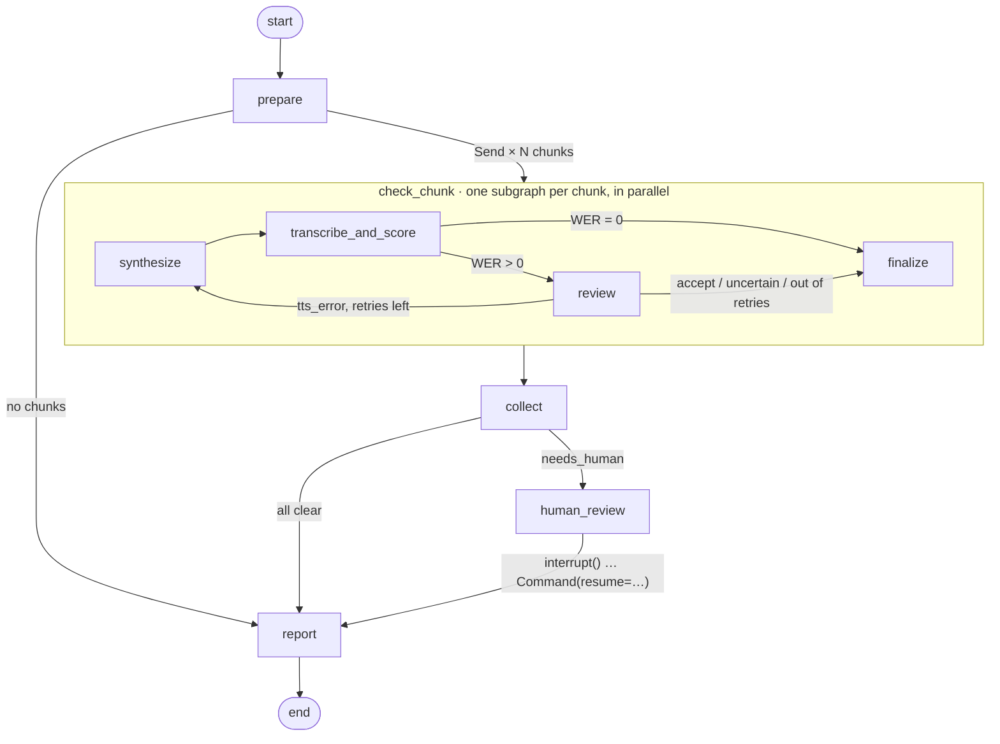

# readback

**A LangGraph agent that proof-listens text-to-speech output.** It synthesizes
each chunk of a text, transcribes the audio back, compares the transcript with the
source text, and escalates only the chunks it cannot clear on its own: first to a
rule set, then to an LLM reviewer with tools, then to a human via `interrupt()`.

```
text ─► TTS ─► STT ─► normalize + WER ─┬─ WER = 0 ───────────────────────► passed
                                       └─ WER > 0 ─► review ─┬─ benign ──► accepted
                                                    ▲        ├─ TTS error ─┐
                                                    └── regenerate ◄───────┘ (n×)
                                                             └─ unsure ──► human review
```

## Background

I first built this as a production pipeline for audiobook production: several
English books, dozens of hours of synthesized audio. Listening to everything would
have taken weeks. Checking audio against text automatically, and having a person
listen only where two automatic checks disagreed, saved about **80 hours** of
listening.

That pipeline was a set of scripts. This repository rebuilds the idea as an
**agent harness**: an explicit LangGraph state machine with parallel fan-out, a
self-correcting regeneration loop, a tool-using LLM reviewer behind MCP,
human-in-the-loop with durable checkpoints, and the API, observability, CI and
Kubernetes work needed to run it as a service.

## Architecture



| Stage | What runs | Cost |
|---|---|---|
| **1 · Normalize + WER** | Reference and transcript are mapped to one spoken form (`2,95 €` ≡ `zwei Euro fünfundneunzig`, `z. B.` ≡ `zum Beispiel`, `3. Mai` ≡ `dritten Mai`). A chunk passes only at WER = 0. | free |
| **2a · Rule reviewer** | Settles the clear cases deterministically: homophones (`das/dass`, `tale/tail`), split compounds, known Whisper hallucinations, truncation, loops, missing words. | free |
| **2b · Regenerate** | On a TTS error the chunk is synthesized again. Deterministic engines such as Piper produce the same defect again, so retries send a *speakable* rewrite of the text instead (numbers and abbreviations written out). | TTS |
| **2c · LLM reviewer** | Only what the rules cannot settle (`reviewer=cascade`): a LangChain `create_agent` with lexicon tools loaded **through MCP**, returning a structured `Verdict`. It can clear unclear cases but never overrule a rule-detected defect. (Attaching the audio is possible but not reliable yet; see Results.) | tokens |
| **3 · Human** | `interrupt()` pauses the run with a review queue. The run survives restarts in the checkpointer and resumes with `Command(resume={chunk_id: {...}})`. | minutes |

**Engines are pluggable** (`providers/`): Piper and faster-whisper (local, offline),
OpenAI or **Azure OpenAI** audio APIs, and deterministic **fake engines** that inject
labelled defects. The fake engines are what make offline tests and evaluation possible.

## Quickstart

```bash
make install                       # venv + package + dev tools
.venv/bin/readback eval            # offline: 146 chunks, injected faults, ground-truth report
```

Real audio, fully local (≈ 1 GB of models):

```bash
make install-local                 # piper-tts + faster-whisper + German/English voices
.venv/bin/readback run corpus/edge_cases/de.yaml --tts piper --stt faster_whisper
```

LLM reviewer (any `init_chat_model` provider):

```bash
echo 'ANTHROPIC_API_KEY=...' >> .env   # or OPENAI_API_KEY / AZURE_OPENAI_*
.venv/bin/readback run corpus --reviewer cascade --model anthropic:claude-opus-5-5
```

Production-like stack with OpenAI audio (`pip install -e '.[openai]'`):

```bash
READBACK_OPENAI_TTS_VOICE=coral READBACK_OPENAI_STT_MODEL=gpt-transcribe \
.venv/bin/readback run corpus --tts openai --stt openai --reviewer cascade --model openai:gpt-5.4-mini
```

As a service (API + Postgres checkpointer):

```bash
docker compose up --build
curl -X POST localhost:8000/v1/runs -H 'content-type: application/json' \
     -d '{"sources": ["edge_cases/de.yaml"], "limit": 20}'
curl localhost:8000/v1/runs/<run_id>                       # status, pending review items
curl -X POST localhost:8000/v1/runs/<run_id>/review -H 'content-type: application/json' \
     -d '{"decisions": {"de-zahl-03": {"approved": false, "note": "says 2004"}}}'
curl localhost:8000/v1/runs/<run_id>/report.md
```

`langgraph.json` is included, so `langgraph dev` opens the graph in LangGraph Studio.

## Results

### Offline evaluation (fake engines, labelled ground truth)

`readback eval` replays the whole corpus. 25 % of takes get a transient TTS defect,
8 % of texts a systematic one that survives retries, and 35 % of transcripts get
benign STT noise (homophone spelling, split compounds, dropped punctuation):

| Seed | WER = 0 | Cleared by review | Human | Defective chunks | **Escaped** | False escalations |
|---:|---:|---:|---:|---:|---:|---:|
| 0 | 106 | 24 | 16 | 16 | **0** | 0 |
| 1 | 103 | 18 | 25 | 24 | **0** | 1 |
| 2 | 107 | 14 | 25 | 25 | **0** | 0 |
| 3 | 98 | 30 | 18 | 17 | **0** | 1 |
| 4 | 109 | 22 | 15 | 15 | **0** | 0 |
| 5 | 110 | 22 | 14 | 13 | **0** | 1 |

More than half of the faulty first takes (143 of 254 across all seeds) are
repaired by regeneration alone, and 80–91 % of the audio never needs a human ear. CI runs this as a **quality gate**
(`readback eval --gate`): the build fails if a single defect escapes or more than
5 % of clean chunks are escalated.

> This evaluation is a regression harness, not a quality claim: the rule reviewer
> knows the kinds of noise the generator produces. The real test is real audio.

### Which reviewer? Rules vs. LLM vs. cascade (ground truth)

The same offline evaluation, with the review stage swapped. LLM: `gpt-5.4-mini` at
low reasoning effort. Three seeds each:

| Reviewer | Escaped defects | False escalations | LLM calls / run | LLM cost / run | Listening saved |
|---|---:|---:|---:|---:|---:|
| Rules only | 0 | 1 | 0 | $0 | 80–87 % |
| LLM only, first prompt | **28 of 34** (seed 0) | 0 | 71 | $0.15 | — |
| LLM only, revised prompt | 2 | 2 | ~100 | $0.17 | 83–93 % |
| **Cascade** (rules → LLM for `uncertain` only) | **0** | 1 | ~11 | **$0.02** | **84–93 %** |

The interesting row is the second. With the first prompt the LLM **explained away
real defects**: swapped words and repeated sentences became "a plausible STT
artifact". The revised prompt names the only acceptable categories and says that
STT engines do not reorder or repeat words. It still accepts single word
substitutions ("were" → "her") as "probably STT". Hence the cascade policy: **the LLM
may clear what the rules call unclear, but it can never overrule a defect the rules
detected.** Without the labelled evaluation, none of this would have been visible.

### Real audio, production-like stack (OpenAI)

`gpt-4o-mini-tts` (voice `coral`) → `gpt-transcribe` → cascade with `gpt-5.4-mini`,
one regeneration, all 146 chunks:

| WER = 0 | Cleared by review | Human | Listening saved | Wall time | LLM cost |
|---:|---:|---:|---:|---:|---:|
| 113 (77 %) | 24 (16 %) | **9 (6 %)** | **92 %** (2.6 of 30.7 min) | 161 s | $0.03 |

The nine escalations are the right ones: a name ("Bolte" → "Beulte"), Busch's
onomatopoeia ("Kikikerikih!!", "herjemineh"), Kafka's "Haremsfrauen", a product name
and a compound the TTS split. The LLM cleared six chunks. Five of those are clearly
right ("vielen/fielen", "learnt/learned", "@" spoken as "at", "=" spoken as "ist").
One is debatable ("Sankt" → "San").

### Audio-listening reviewer: tested, not adopted

The original pipeline used a multimodal LLM as a second opinion, so I tried attaching
the audio (`READBACK_ATTACH_AUDIO=true`) and checked whether the model actually
listens. The check used **controls on audio known to be correct** (WER 0 with two
different Whisper models): (a) correct text with a corrupted transcript must give
*accept*; (b) a corrupted text with a correct transcript must give *tts_error*.

| Model | (a) accept expected | (b) tts_error expected |
|---|---|---|
| `gpt-audio-mini`, with transcript and diff | 0 / 10 | 10 / 10 |
| `gpt-audio`, with transcript and diff | 0 / 10 | 10 / 10 |
| `gpt-audio-mini`, blind (text + audio only) | 1 / 10 (invents deviations) | 10 / 10 |
| `gpt-audio`, blind | refuses: "I can't listen to audio" | refuses |

With the diff in the prompt, both models simply confirm the text difference. The
naive spot check before that looked perfect (3 of 3 "correct" verdicts), and only
the controls exposed it. Audio review therefore stays an opt-in extension point,
and the default reviewer works from text only.

### Real audio, local stack (Piper → faster-whisper, CPU)

The cheapest possible stack: Piper `thorsten`/`lessac` medium voices and
faster-whisper on CPU, rules only, one regeneration.

| Setup (all 146 chunks) | WER = 0 | Cleared by rules | Human | Listening saved |
|---|---:|---:|---:|---:|
| Whisper `small`, first take only | 33 | 5 | 108 | 24 % |
| Whisper `small` + speakable regeneration (full graph) | 42 | 6 | 98 | 29 % |
| Whisper `large-v3-turbo`, first take only (same audio) | 49 | 9 | 88 | 35 % |

Nothing in the corpus is easy. Short edge cases pass far more often (en: 11/20 at
WER 0) than Kafka's 400-character sentences in old spelling (1/33 with `small`,
5/33 with `turbo`). What the pipeline actually caught:

- **Real TTS defects, repaired automatically.** Piper reads `z. B.` and `d. h.` as
  letters ("ZB", "DH") and `39,5 °C` as "… Grad C". The speakable retry sends
  "zum Beispiel" or "neununddreißig Komma fünf Grad Celsius", and the second take
  passes at WER 0. Regeneration fixed 10 of 79 chunks this way.
- **Real TTS defects that need a person.** Roman numerals come out as "Roman 4".
  `St. James St.` comes out as "Oncent, Jamescent", and the lexicon's rewrite
  ("Saint James Saint") is wrong as well, because *St.* is ambiguous. The German
  voice mangles English INCI ingredient names ("Glycerin" becomes "Lügerin"). All
  of these are escalated, which is correct.
- **The STT model is the biggest lever.** Most remaining escalations are
  transcription errors on a synthetic voice ("dachte" becomes "gachte", "rabbit"
  becomes "rabbits"). Moving from `small` to `large-v3-turbo` cleared 20 more
  chunks without changing anything else.
- **Blind spots behave as predicted.** The homograph and prosody items
  (*modern/modern*, *read/read*, *Komm, wir essen, Opa!*) pass at WER 0, whether or
  not the stress was right. The round trip cannot tell.

Running the cascade reviewer (`gpt-5.4-mini`) over the 98 escalations of this local
run cleared 11 more chunks for $0.11. At least two of those clearances are wrong.
One is "gültiges" → "giltiges": both Whisper models hear this identically, so Piper
probably mispronounces it. From text alone, an LLM cannot tell an STT mishearing
from a TTS mispronunciation. Comparing the two stacks, voice and STT quality matter
far more than any reviewer.

## The test corpus

146 chunks in German and English, built so that every stage gets exercised,
including the cases the method is **blind** to. See [corpus/README.md](corpus/README.md).

- **Curated edge cases**: numbers, prices, dates, abbreviations, acronyms,
  homophones, homographs, compounds, `ß`, foreign words, phone numbers, URLs, emoji.
  Each item states which stage *should* settle it.
- **Retail domain texts** (fictional products): prices and base prices, dosage,
  INCI ingredient lists, safety notes. This is the material where a misread
  word matters.
- **Public-domain literature**: Kafka's *Die Verwandlung* (long nested sentences,
  old spelling), Busch's *Max und Moritz* (verse, archaic words, onomatopoeia) and
  Carroll's *Alice* (the original English audiobook use case, with the *tale/tail*
  and *not/knot* puns that make homophones a real test).

## MCP

`readback.mcp_server` exposes two kinds of tools:

- **Lexicon tools** (`expand_for_speech`, `normalize_text`, `lookup_abbreviation`,
  `check_homophones`, `compare_texts`). The **LLM reviewer consumes these over
  stdio** via `langchain-mcp-adapters`, so the same capabilities are available to
  any MCP client. Further servers can be attached with `READBACK_MCP_SERVERS`.
- **`run_qa`**, the whole pipeline as one tool. `.mcp.json` registers the server
  for Claude Code, so "check this paragraph for TTS problems" works from the editor.

## Operations

- **API** (`api.py`): async runs, status, review submission, retry from the last
  checkpoint, `/healthz`, `/readyz`, `/metrics`. Run state lives only in the
  checkpointer (memory, SQLite or Postgres), so every replica can answer reads.
- **Observability**: Prometheus counters and histograms per stage, provider,
  verdict and model (tokens and estimated USD cost per reviewer), JSON logs, and
  LangSmith tracing via environment variables.
- **Cost control**: rules run before the LLM, the LLM sees only unresolved chunks,
  and it runs at `reasoning_effort=low`. The report shows the LLM spend per run.
- **Deployment**: multi-stage non-root Docker image; `deploy/k8s` has a kustomize
  base for **AKS** with Workload Identity, Key Vault through the Secrets Store CSI
  driver, HPA, PDB, a read-only root filesystem and probes.
- **CI** (`.github/workflows/ci.yml`): ruff, mypy, pytest on Python 3.11 and
  3.13, the evaluation gate (report in the job summary) and the image build.

## Design notes and trade-offs

- **Symmetric normalization.** Reference and transcript go through the *same*
  function, so consistency matters more than linguistic correctness. Rules that
  could hide a real defect (`ß → ss`, inflected ordinals reduced to their stem)
  are documented, and the corpus contains `blind` items for them.
- **Rules before LLM, and the LLM cannot overrule them.** Most differences are
  boring (homophones, compounds). A deterministic first pass is free and
  explainable. The LLM only sees what the rules call unclear, because the
  evaluation showed that it rationalizes real defects away when it is allowed to
  judge them.
- **Fail safe.** If a review call fails (API error, invalid structured output), the
  chunk goes to a human instead of the run crashing. One malformed verdict
  originally aborted a whole 146-chunk run.
- **Provider quirks live in one place.** OpenAI reasoning models only combine
  tools with `reasoning_effort` on the Responses API. Audio models need chat
  completions and tool-call structured output. Claude Opus 5.5 rejects forced tool
  choice. `review/llm.py` handles all three behind one `init_chat_model` string.
- **Retries must vary the input.** "Regenerate" helps stochastic neural TTS, but a
  deterministic engine reproduces the same defect. `regeneration_strategy=speakable`
  sends the expanded text on retries instead.
- **Blind spots are explicit.** Wrong stress on homographs or meaning carried by a
  comma produce a perfect transcript. A round trip cannot see them, and the audio
  models tested so far could not either. The corpus marks these cases so nobody
  mistakes them for a pass.
- **Execution model.** Runs execute as background tasks inside the API process.
  That is enough for a demo; at scale I would move execution to a worker queue (or
  LangGraph Platform) and keep the API stateless. The checkpointer already makes
  that a deployment change rather than a rewrite.
- **Pinned `mcp<2`.** `langchain-mcp-adapters` does not support the MCP SDK 2.x
  API yet.

## Layout

```
src/readback/
  graph/        pipeline.py (top graph) · chunk.py (per-chunk subgraph) · state.py
  review/       rules.py · llm.py (agent + tools + Verdict) · cascade/factory
  providers/    fake.py · local.py (Piper, faster-whisper) · openai_compat.py (OpenAI/Azure)
  normalize.py  lexicon.py  scoring.py  faults.py  corpus.py  report.py  results.py
  api.py  cli.py  mcp_server.py  services.py  checkpointing.py  observability.py  config.py
corpus/         edge cases (de/en), retail domain, public-domain literature
deploy/k8s/     AKS kustomize base
tests/          unit, graph (interrupt/resume), API, MCP, LLM reviewer with a scripted model
```

## Development

```bash
make lint test eval
```

The repository was developed with Claude Code. `CLAUDE.md` holds the project
conventions, and `.claude/settings.json` together with `.mcp.json` give the agent
the test commands and the project's own MCP tools.

## License

MIT for the code. The literature excerpts are in the public domain (see `corpus/README.md`).
